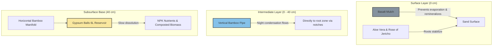
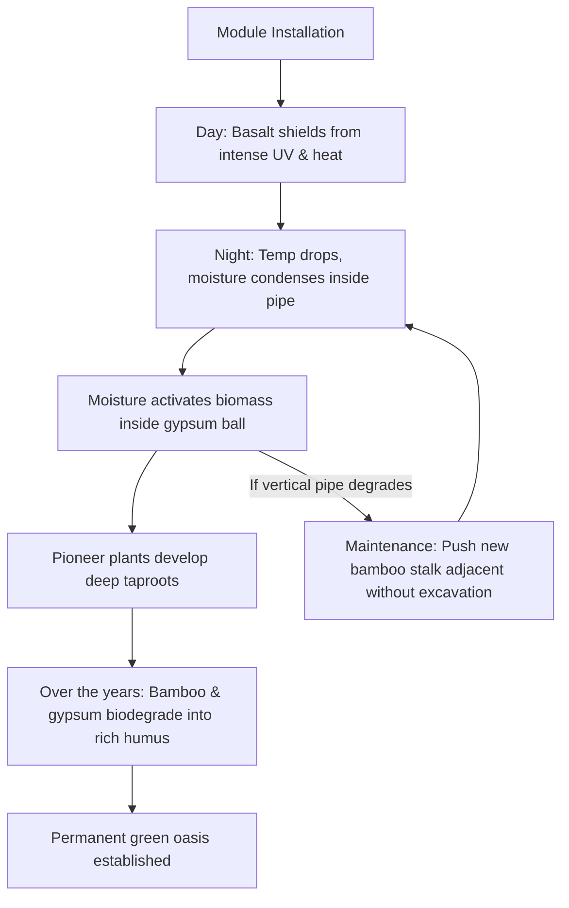

# 💧 One Drop Oasis: Passive Anti-Desertification Module

This project introduces a fully autonomous, low-cost biological innovation designed to combat desertification. Operating entirely without electricity, plastics, or complex grid-tied irrigation systems, the module leverages the laws of physics, diurnal temperature variations, and biodegradable materials to create permanent, self-sustaining green oases in extreme arid environments.

## 🛠️ Mechanical Architecture & Stratigraphy

The module is installed vertically into the terrain to optimize the local microclimate and eliminate water evaporation:

*   **Surface Layer (0 cm):** The ground surface is covered with a layer of crushed volcanic **basalt**. This acts as a mechanical moisture barrier (mulching) that prevents the sun from baking the sand, drastically reducing evaporation. Over time, it slowly dissolves to remineralize the soil with essential micronutrients (magnesium, iron, calcium).
*   **Intermediate Layer (0–40 cm):** A vertical, hollow **bamboo pipe** equipped with directional notches and a protective cap. The pipe functions as a passive atmospheric water condenser: during the cold desert nights, ambient humidity condenses on the pipe walls (sweating effect) and drains through the notches directly past the parched surface sand into the deeper root zone.
*   **Subsurface Base (40 cm):** A subterranean, square-shaped bamboo pipe manifold. Positioned at the corner connection joints are hollow **gypsum balls (12 mm wall thickness, 25 cm outer diameter)**.

## 🧬 Biological Ecosystem & 6L Nutrient Reservoir

*   **The Gypsum Cradle:** The internal volume of the sphere is exactly **6 liters** and is packed with processed (sterilized and composted) organic biomass. The gypsum (calcium sulfate) protects the biomass from drying out. Moisture triggers a slow dissolution of the shell, which improves soil structure and releases a massive NPK (Nitrogen, Phosphorus, Potassium) nutrient payload in a highly controlled manner.
*   **40 cm Optimal Depth:** At this depth, the desert soil temperature remains stable (approx. 25–30 °C) even when surface temperatures exceed 60 °C. This shields the root system from thermal shock and forces the pioneer plants to develop robust, downward-anchored taproots.
*   **Aloe Vera & Resurrection Plant Symbiosis:** *Aloe Vera* is planted at the surface. As it grows, parts of its succulent leaves are harvested and crushed around the base. The natural aloe gel acts as an organic hydrogel, binding loose sand particles and maintaining topsoil moisture. 
*   In tandem, a resurrection plant species like the **Rose of Jericho** (*Selaginella lepidophylla*) is introduced. It survives droughts by rolling into a dormant ball but revives and turns green within hours of receiving night-time condensation. Its roots physically lock the basalt mulch and topsoil against wind erosion.

## 🔄 Lifecycle and Modular "Hands-Free" Maintenance

*   **Zero-Waste Degradation:** The underground bamboo network naturally biodegrades over several years, converting into rich organic humus that permanently heals the desert soil substrate.
*   **Infinite Serviceability:** If the above-ground vertical pipe degrades under intense UV radiation, repair is completely "hands-free": a new bamboo stalk can simply be pushed through the sand adjacent to the old one without any excavation, automatically tapping into the existing 40 cm moisture zone.

## 📄 License

This project is licensed under the **MIT License** – keeping the original architecture credited to the creator.

Copyright (c) 2026 masakertsa
